# 🏥 MediFlow Enterprise — Clinical Management System (Backend API)

<div align="center">

[](https://dotnet.microsoft.com/)
[](https://learn.microsoft.com/dotnet/csharp/)
[](https://www.postgresql.org/)
[](https://learn.microsoft.com/ef/core/)
[](https://github.com/jbogard/MediatR)
[](https://learn.microsoft.com/aspnet/core/signalr/)
[](https://jwt.io/)
[](tests/)
[](https://www.hhs.gov/hipaa/)
[](LICENSE)

<p align="center">
  <b>High-Throughput, HIPAA-Compliant Healthcare Information System (HIS) & Electronic Health Records (EHR) Web API.</b>
  <br />
  Engineered with <b>Clean Architecture</b>, <b>MediatR CQRS</b>, <b>PostgreSQL 17</b>, and <b>Real-Time SignalR WebSockets</b>.
</p>

</div>

---

## 📋 Table of Contents
1. [Executive Overview](#-executive-overview)
2. [Visual UI & 9-Role Cockpit Showcase](#-visual-ui--9-role-cockpit-showcase)
3. [Architecture & System Design](#-architecture--system-design)
4. [12 Comprehensive Clinical & Enterprise Modules](#-12-comprehensive-clinical--enterprise-modules)
5. [Policy-Based Access Control (PBAC) & Permissions](#-policy-based-access-control-pbac--permissions)
6. [Real-Time Clinical Event Stream (SignalR)](#-real-time-clinical-event-stream-signalr)
7. [Database Schema & Migrations](#-database-schema--migrations)
8. [Getting Started & Installation](#-getting-started--installation)
9. [Automated Test Suite & Quality Gates](#-automated-test-suite--quality-gates)
10. [Security & HIPAA Compliance](#-security--hipaa-compliance)

---

## 🌟 Executive Overview

**MediFlow Enterprise** is an enterprise-grade Hospital Information System (HIS) and Electronic Medical Record (EMR) backend designed to power clinical workflows, diagnostic laboratories, digital radiology suites, inventory dispensaries, financial ledgers, and patient portals.

### Core Architectural Pillars
- **Clean Architecture & Domain-Driven Design (DDD):** Strict separation between Domain entities, MediatR Application commands/queries, Infrastructure persistence, and REST API controllers.
- **CQRS Pattern with MediatR:** Isolated read models and transactional write operations validated through FluentValidation pipeline behaviors.
- **PostgreSQL 17 Persistence with EF Core:** High-performance relational schema with composite indexes, foreign key referential integrity, optimistic concurrency tokens, and automated migrations.
- **Zero-Latency SignalR WebSockets:** Instantaneous real-time broadcasts for triage queue progression, critical lab alerts, urgent stat radiology studies, and cashier billing notices.
- **Enterprise Security & PBAC:** Granular policy-based access control safeguarding 9 discrete healthcare roles with full HIPAA audit trails.

---

## 🖥️ Visual UI & 9-Role Cockpit Showcase

The API powers 9 role-specific web cockpits in the [MediFlow Web Client](https://github.com/Merdikai/Clinic-client), featuring unified **Light Theme** and **Deep Dark Blue (Midnight Slate)** theme support:

### 1. Medical Doctor & Clinical Cockpit
> Real-time consultation queue, patient history timeline, ICD-10 diagnostic coding, and structured SOAP clinical encounters.

<div align="center">
  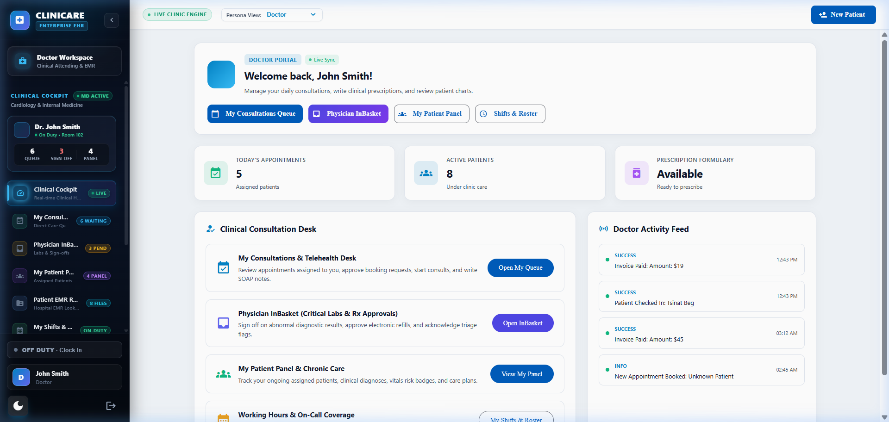
  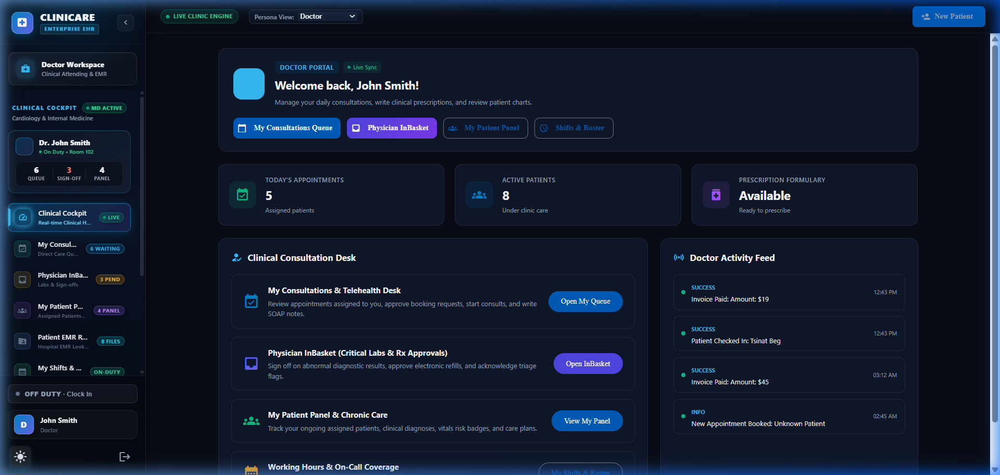
</div>

<div align="center">
  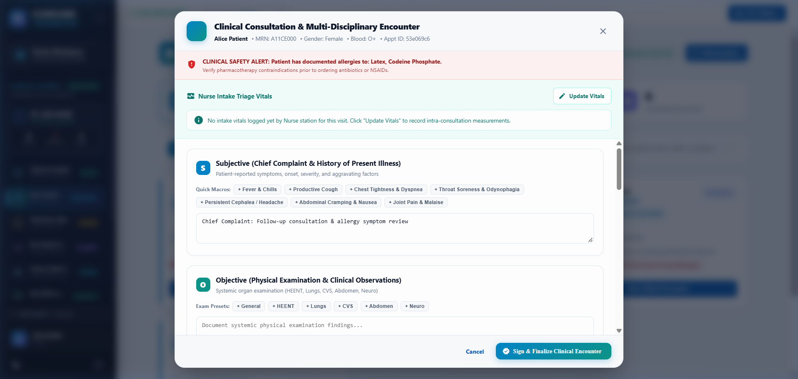
</div>

---

### 2. Clinical Nurse Triage Desk & Emergency Vitals
> Instant triage classification (Resuscitation, Emergent, Urgent, Non-Urgent), live vital sign telemetry, and pain score monitoring.

<div align="center">
  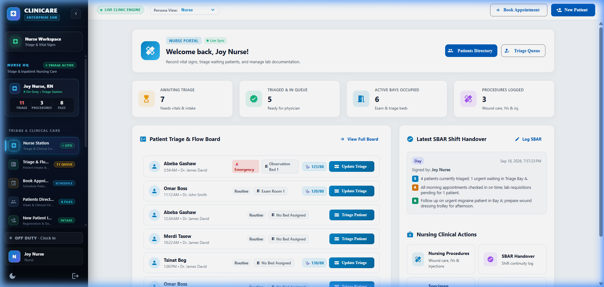
  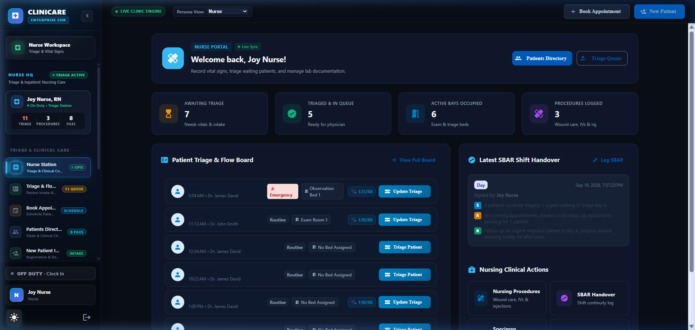
</div>

---

### 3. Hospital Administration & PBAC Governance
> Multi-role shift rostering, PBAC policy matrices, staff onboarding, and tamper-evident HIPAA security audit logs.

<div align="center">
  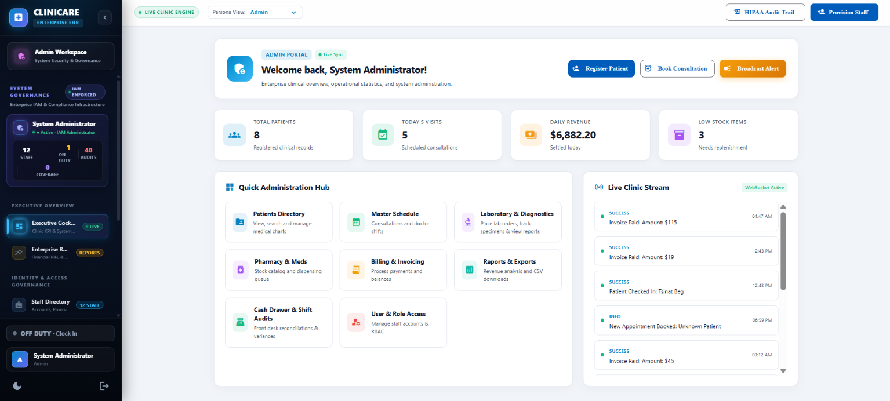
  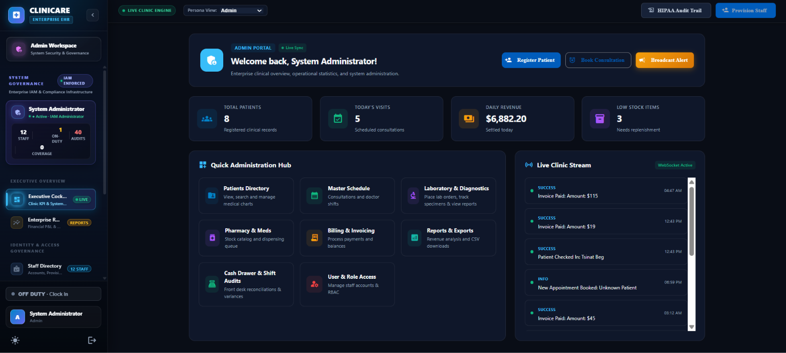
</div>

<div align="center">
  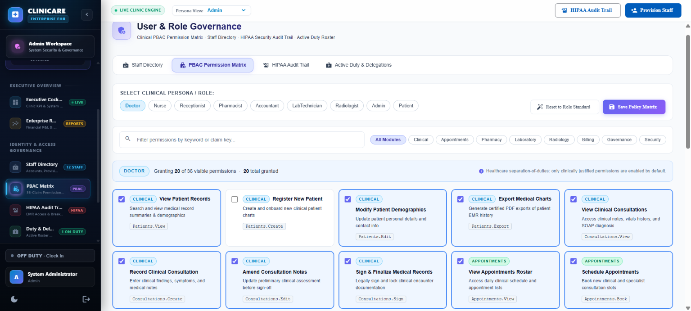
  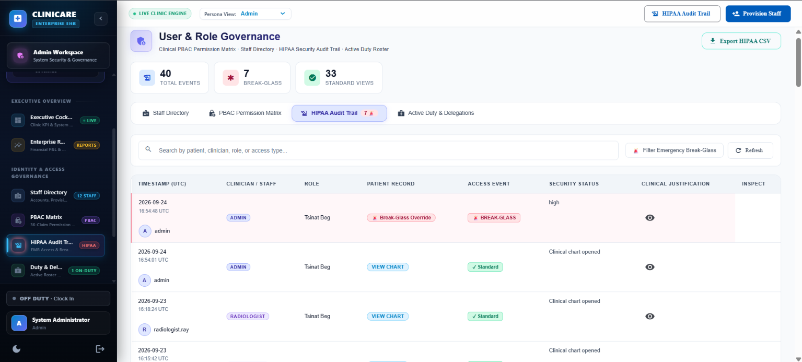
</div>

---

### 4. Financial Cockpit, Billing & Insurance Clearinghouse
> Accounts Receivable/Payable ledgers, cashier drawer reconciliations, automated invoice generation, and electronic insurance claims.

<div align="center">
  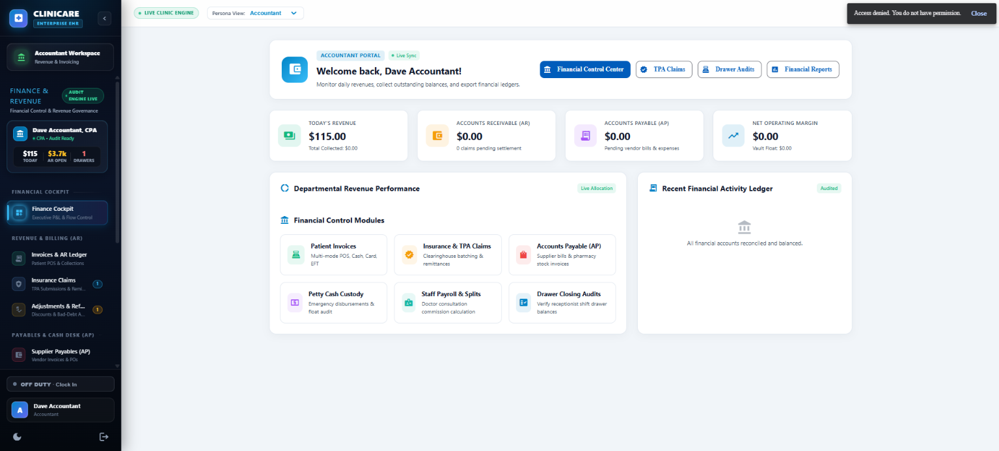
  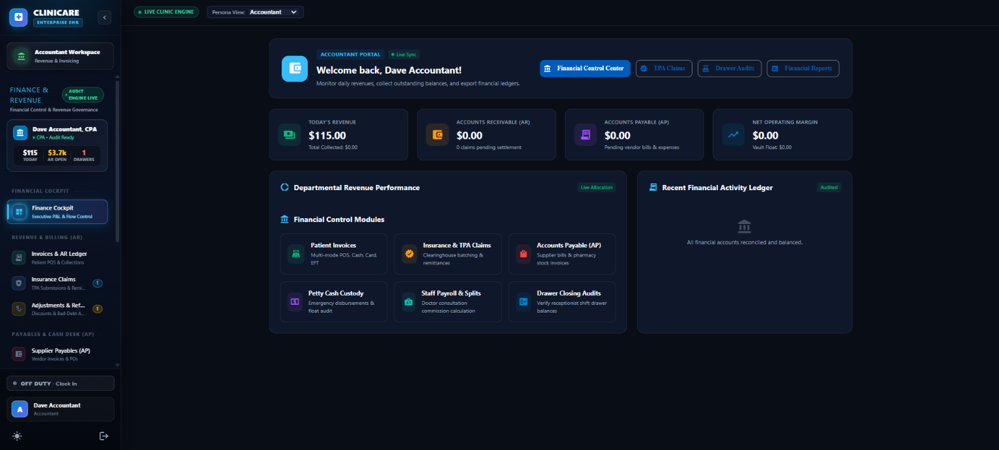
</div>

---

### 5. Pharmacy Information System (PIS) & Dispensary
> Digital prescription fulfillment queue, formulary inventory management, batch expiry tracking, and Schedule II controlled substances log.

<div align="center">
  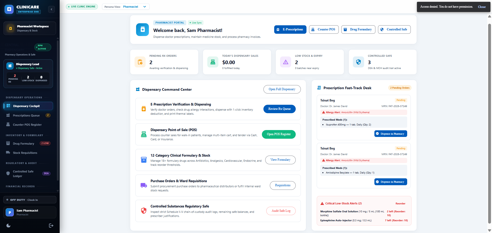
  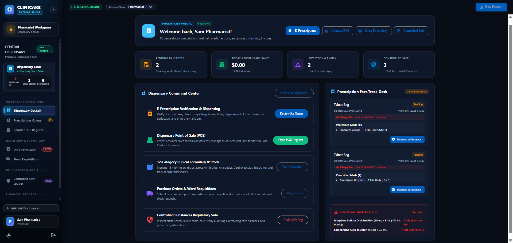
</div>

---

### 6. Laboratory Information System (LIMS) & Accessioning
> Specimen accessioning, automated barcoding, hematology/biochemistry analyzer worklist, and critical delta-check alerts.

<div align="center">
  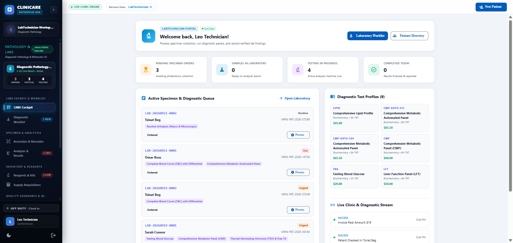
  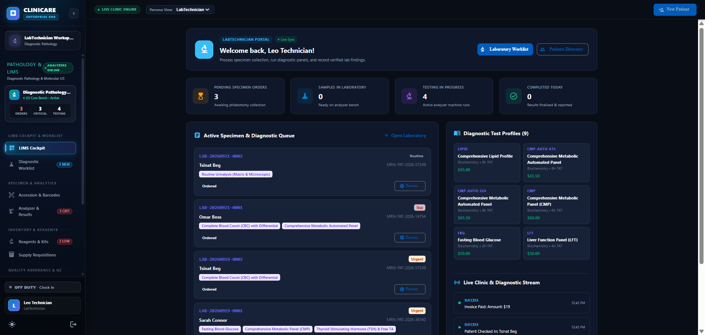
</div>

---

### 7. Radiology Information System (RIS) & Web-PACS Workstation
> Diagnostic modality worklists (X-Ray, CT, MRI, Ultrasound), DICOM viewer integration, and structured radiological sign-off reports.

<div align="center">
  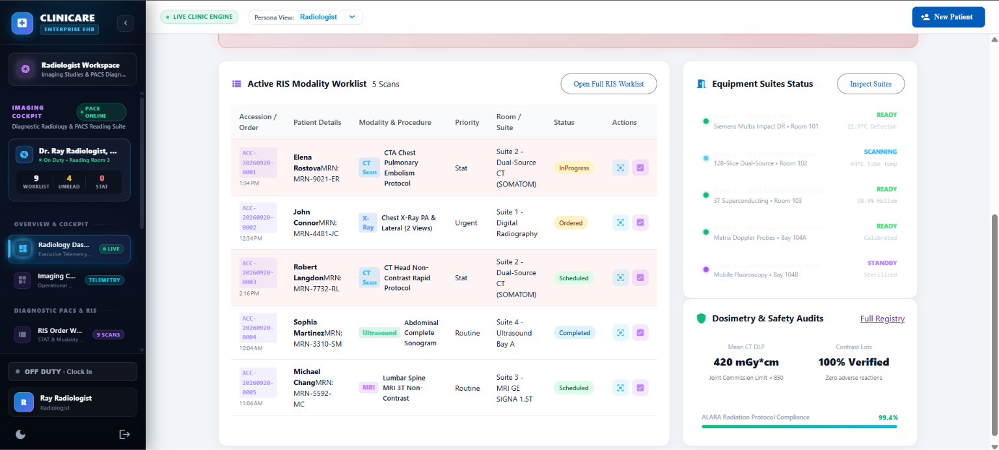
  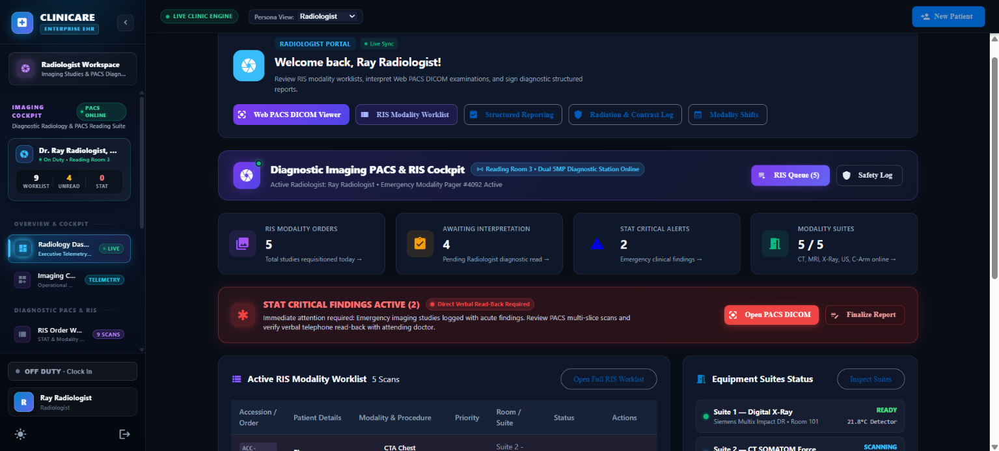
</div>

---

### 8. Receptionist Arrival Desk & Master Patient Index (MPI)
> Walk-in registration, outpatient appointment booking, queue ticket generation, and front-desk cashier settlement.

<div align="center">
  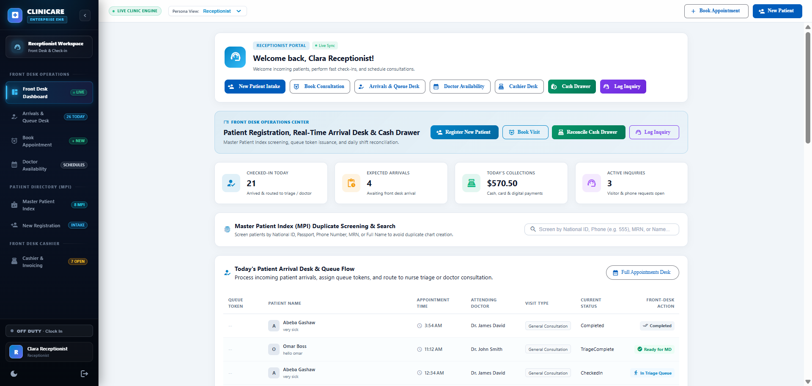
  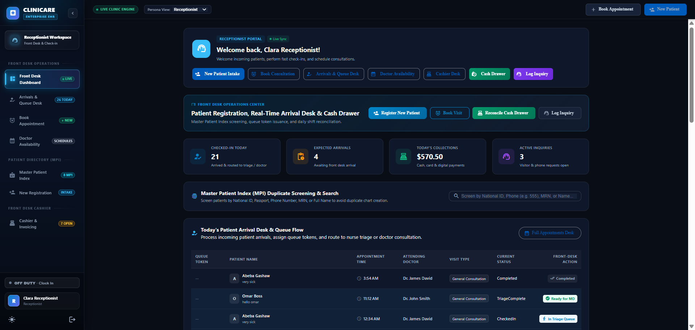
</div>

---

### 9. Patient Health Portal
> Secure digital access to personal medical history, scheduled consultations, active prescriptions, and certified lab reports.

<div align="center">
  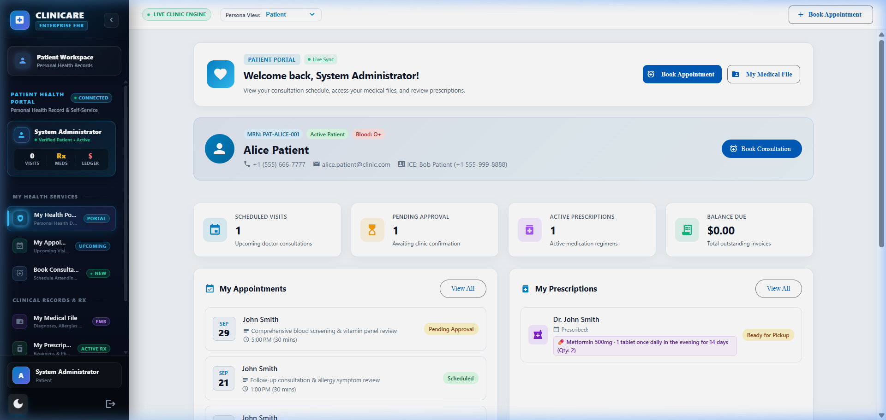
</div>

---

## 🏛️ Architecture & System Design

MediFlow adheres strictly to the **Clean Architecture** paradigm, ensuring enterprise modularity, testability, and technological independence:

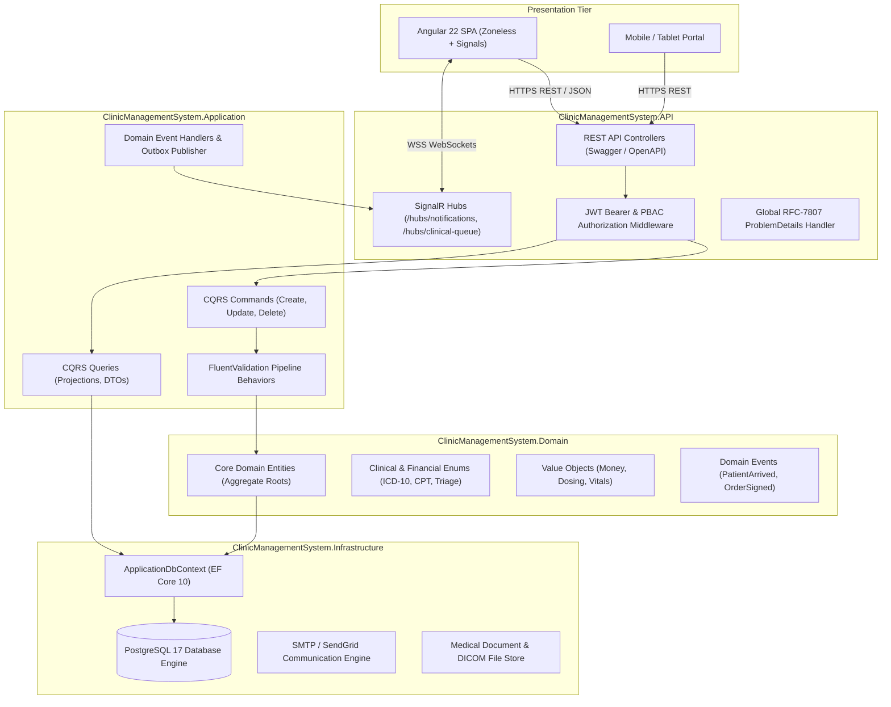

---

## 📦 12 Comprehensive Clinical & Enterprise Modules

The backend implements all 12 modules defined in the healthcare operational standard:

| # | Module | Scope & Core Capabilities | Primary Controllers |
|---|---|---|---|
| **01** | **Master Patient Index (MPI)** | Comprehensive demographics, national IDs, emergency contacts, blood groups, and insurance policy verification. | `PatientsController` |
| **02** | **Electronic Medical Records (EMR)** | Clinical encounter tracking, SOAP notes (Subjective, Objective, Assessment, Plan), allergy alerts, and diagnosis histories. | `ConsultationsController`, `MedicalRecordsController` |
| **03** | **Scheduling & Shift Rostering** | Multi-provider appointment booking, room assignments, doctor shift scheduling, check-in queue management. | `AppointmentsController`, `RostersController` |
| **04** | **Clinical Triage & Vitals** | Emergency severity index (ESI), automated vital sign alerts (BP, SpO2, HR, Temp, RR), and nurse queue prioritization. | `TriageController`, `VitalsController` |
| **05** | **Pharmacy Information System (PIS)** | Drug formulary catalog, e-prescriptions, automated batch inventory deduction, reorder alerts, and controlled substance ledgers. | `PharmacyController`, `PrescriptionsController` |
| **06** | **Laboratory Information (LIMS)** | Specimen accessioning, test panels (CBC, BMP, Lipid), reference range flags, delta-checks, and automated result validation. | `LabOrdersController`, `LabTestsController` |
| **07** | **Radiology Information System (RIS)** | Modality worklists (X-Ray, CT, MRI, Ultrasound), PACS workstation linking, and structured radiological reports. | `RadiologyOrdersController`, `ModalityController` |
| **08** | **Outpatient Cashier & Invoicing** | Comprehensive itemized bills, tax computation, cash drawer shifts, split payments (Cash, Card, Transfer), and PDF receipts. | `BillingController`, `InvoicesController` |
| **09** | **Insurance Claims Clearinghouse** | EDI claim generation, pre-authorization tracking, policy deductible deductions, and remittance reconciliation. | `InsuranceClaimsController` |
| **10** | **Accounts Payable (AP) & Petty Cash** | Medical vendor invoices, supply expense settlement, disbursement approvals, and petty cash float reconciliation. | `AccountsPayableController`, `PettyCashController` |
| **11** | **Staff Payroll & Commissions** | Multi-role staff directory, automated salary computation, doctor consultation commissions, and payroll disbursements. | `StaffController`, `PayrollController` |
| **12** | **HIPAA Security & Audit Trails** | Tamper-evident logging of every PHI access, role delegations, PBAC permission enforcement, and cryptographic authentication. | `AuditTrailController`, `AuthController`, `UsersController` |

---

## 🛡️ Policy-Based Access Control (PBAC) & Permissions

Security is enforced at both the API Gateway and MediatR request boundary using ASP.NET Core Claims and Policy-Based Authorization:

| Healthcare Role | EMR / SOAP | Triage & Vitals | Pharmacy / Rx | LIMS Lab | RIS Radiology | Billing & Cashier | Insurance Claims | Staff & Roster | Audit Logs |
|---|:---:|:---:|:---:|:---:|:---:|:---:|:---:|:---:|:---:|
| **Admin** | Read | Read | Read | Read | Read | Full | Full | **Full** | **Full** |
| **Doctor** | **Full** | Read | Sign/Order | Order/Review | Order/Review | Read | Read | Read Schedule | View Own |
| **Nurse** | Read/Note | **Full** | Administer | Collect/Track | Prep/Track | Read | Read | Read Schedule | View Own |
| **Receptionist**| Read Demog | Check-In | - | - | - | **Cashier** | Verify Policy | View Roster | View Own |
| **Pharmacist** | Read Rx | - | **Dispense/Stock** | - | - | Invoice Rx | Read | Read Schedule | View Own |
| **Accountant** | Read Financial| - | Inventory Cost | Bill Review | Bill Review | **Full** | **Full** | **Payroll** | Financial Audit |
| **Lab Technician**| Read Orders| - | - | **Run/Verify** | - | Bill Tests | Read | Read Schedule | View Own |
| **Radiologist** | Read Orders | - | - | - | **Sign/Report** | Bill Studies | Read | Read Schedule | View Own |
| **Patient** | View Own | View Own | View Own Rx | View Own | View Own | Pay Own | View Claims | - | - |

---

## ⚡ Real-Time Clinical Event Stream (SignalR)

MediFlow broadcasts domain state changes via bidirectional SignalR WebSockets:

- **`/hubs/clinical-queue`**:
  - `PatientCheckedIn`: Alerts triage nurses and doctor queues of patient arrival.
  - `TriageCompleted`: Updates patient acuity tier in the doctor cockpit.
  - `ConsultationStarted` / `ConsultationCompleted`: Updates real-time wait times and cashier desk.
- **`/hubs/notifications`**:
  - `CriticalLabAlert`: Immediate high-priority notification to attending physician when panic lab values occur.
  - `StatRadiologyOrder`: Notifies on-duty radiologist of emergency imaging requirements.
  - `LowStockAlert`: Notifies pharmacy director when critical drugs fall below safety stock.
  - `InvoiceSettled`: Synchronizes accounting ledger upon cashier payment.

---

## 🗄️ Database Schema & Migrations

The database engine is **PostgreSQL 17** managed via Entity Framework Core code-first migrations.

### Key Database Conventions
- **Audit Columns:** Every table implements `CreatedAt`, `CreatedBy`, `LastModifiedAt`, and `LastModifiedBy`.
- **Soft Deletion:** Core master records employ `IsDeleted` and `DeletedAt` query filters to preserve audit integrity.
- **Optimistic Concurrency:** RowVersion tokens protect critical transactions (inventory deduction, billing settlement).
- **Indexing:** High-performance B-tree and composite indexes on `PatientId`, `AppointmentDate`, `Status`, and `NationalId`.

### Applying Database Migrations
```bash
# Verify connection string in appsettings.json
dotnet ef database update --project src/ClinicManagementSystem.Infrastructure --startup-project src/ClinicManagementSystem.API
```

---

## 🚀 Getting Started & Installation

### Prerequisites
- [.NET 10 SDK](https://dotnet.microsoft.com/download/dotnet/10.0) (or latest LTS)
- [PostgreSQL 16+](https://www.postgresql.org/download/)
- [Git](https://git-scm.com/)

### Step 1: Clone Repository
```bash
git clone https://github.com/Merdikai/ClinicManagementSystem.git
cd ClinicManagementSystem
```

### Step 2: Configure Environment Settings
Copy the template configuration files:
```bash
cp src/ClinicManagementSystem.API/appsettings.template.json src/ClinicManagementSystem.API/appsettings.json
cp src/ClinicManagementSystem.API/appsettings.Development.template.json src/ClinicManagementSystem.API/appsettings.Development.json
```

Edit `src/ClinicManagementSystem.API/appsettings.json` with your PostgreSQL database credentials:
```json
{
  "ConnectionStrings": {
    "DefaultConnection": "Host=localhost;Port=5432;Database=ClinicManagementDb;Username=postgres;Password=YOUR_SECURE_PASSWORD"
  },
  "JwtSettings": {
    "Secret": "ENTER_YOUR_SECURE_256_BIT_SECRET_KEY_HERE_MIN_32_CHARS",
    "Issuer": "ClinicManagementSystem",
    "Audience": "ClinicManagementSystemClient",
    "ExpiryMinutes": 60
  }
}
```

### Step 3: Run Database Migrations & Seed Data
```bash
dotnet ef database update --project src/ClinicManagementSystem.Infrastructure --startup-project src/ClinicManagementSystem.API
```

### Step 4: Run the Web API
```bash
dotnet run --project src/ClinicManagementSystem.API
```

The Web API will launch locally at:
- **API Base URL:** `http://localhost:5041`
- **Interactive Swagger UI:** `http://localhost:5041/swagger`
- **SignalR Queue Hub:** `http://localhost:5041/hubs/clinical-queue`
- **SignalR Notifications:** `http://localhost:5041/hubs/notifications`

---

## 🧪 Automated Test Suite & Quality Gates

MediFlow maintains a continuous quality pyramid with 100% passing tests and zero compiler warnings:

```
Total Test Suites: 2 projects (Unit & Integration)
Total Tests:       80 Passing (66 Unit + 14 Integration)
Compiler Warnings: 0
Compiler Errors:   0
```

### Execute Test Suite
```bash
# Run all unit and integration tests
dotnet test ClinicManagementSystem.slnx
```

### Test Coverage Highlights
- **Domain Entity Invariants:** Validates business logic, dosage calculations, and status transitions.
- **MediatR Pipeline Behaviors:** Tests FluentValidation rules, exception transformations, and cancellation token propagation.
- **Integration Test Suite:** Uses `WebApplicationFactory<Program>` with an isolated test database to verify HTTP status codes, JWT claims, and database commits.

---

## 🔒 Security & HIPAA Compliance

MediFlow was engineered from the ground up with clinical security compliance in mind:

- **Cryptographic Password Hashing:** ASP.NET Core Identity PBKDF2 with SHA-512 and unique per-user salts.
- **Token Security:** Short-lived JWT access tokens paired with HttpOnly refresh tokens featuring automated reuse detection and revocation.
- **Audit Logging:** Implements an immutable `AuditLog` table capturing actor ID, timestamp, IP address, HTTP action, resource entity, old values, and new values for every write operation.
- **Data Protection at Rest & Transit:** Enforced TLS 1.3 for API endpoints and encrypted database connections.
- **CORS Protection:** Strict origin whitelisting restricting API communication exclusively to authorized clinic web and mobile clients.

---

## 👥 Engineering & Authorship

- **Architecture & Full-Stack Engineering:** MediFlow Development Team
- **Frontend Companion Repository:** [MediFlow Web Client (Angular 22)](https://github.com/Merdikai/Clinic-client)

---

<div align="center">
  <sub>Built with ❤️ for modern healthcare professionals. Compliant with international medical documentation standards.</sub>
</div>
